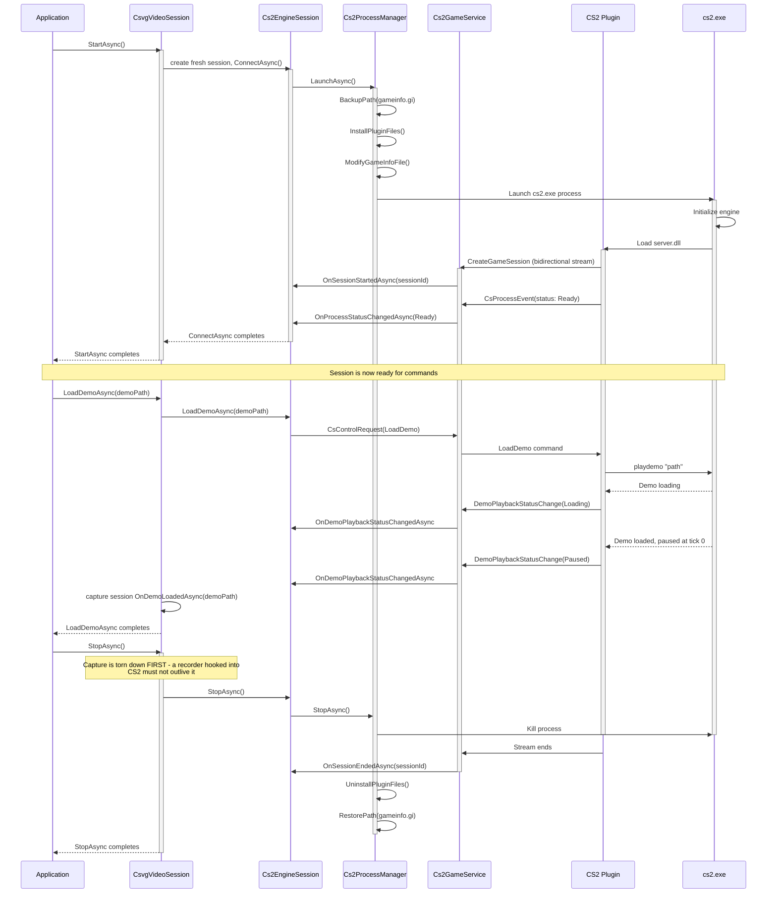
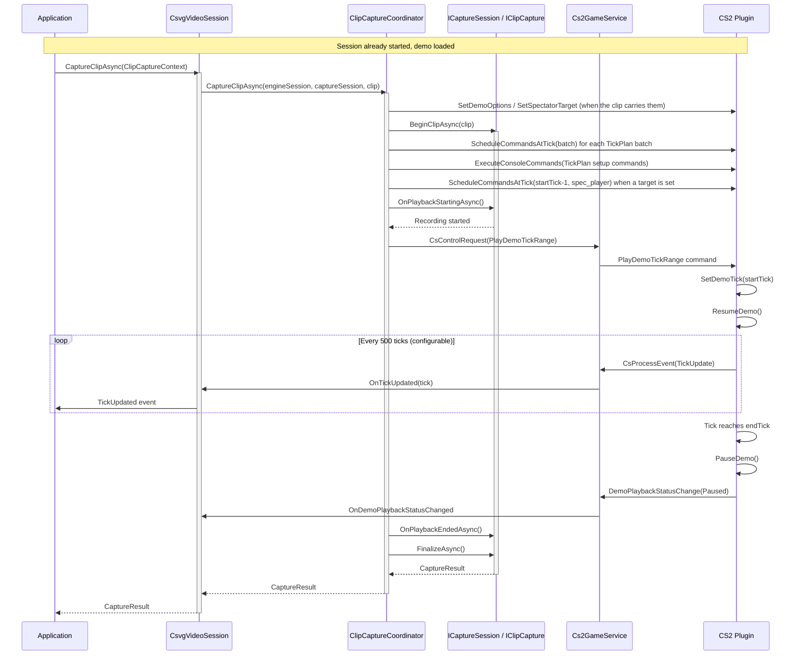
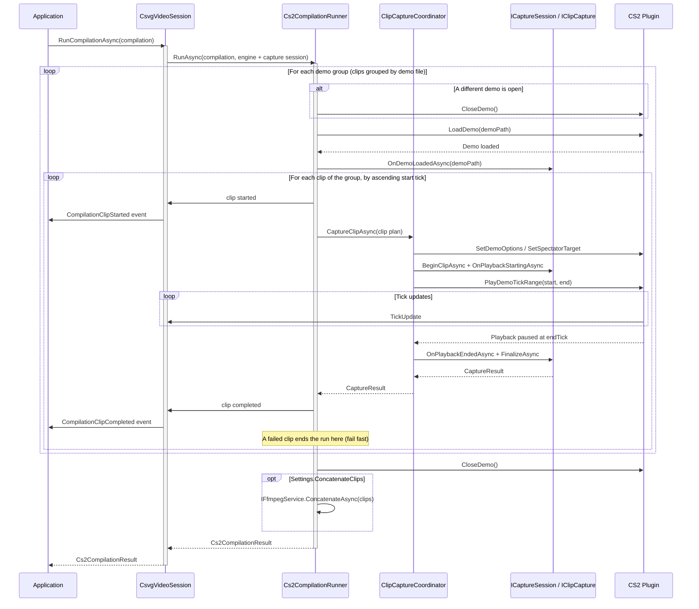
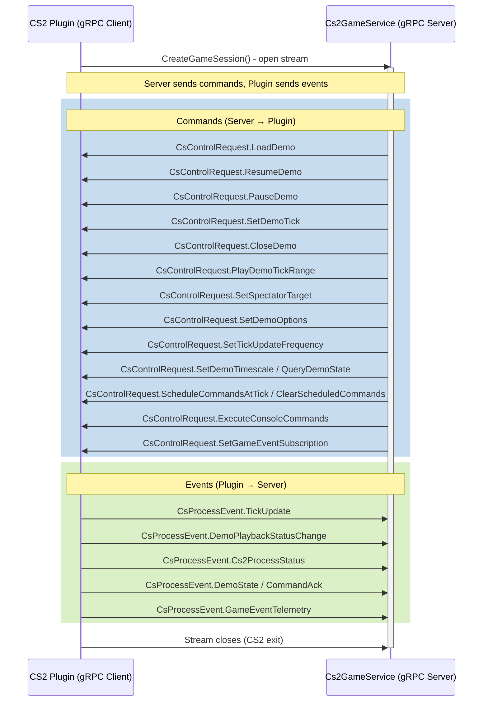
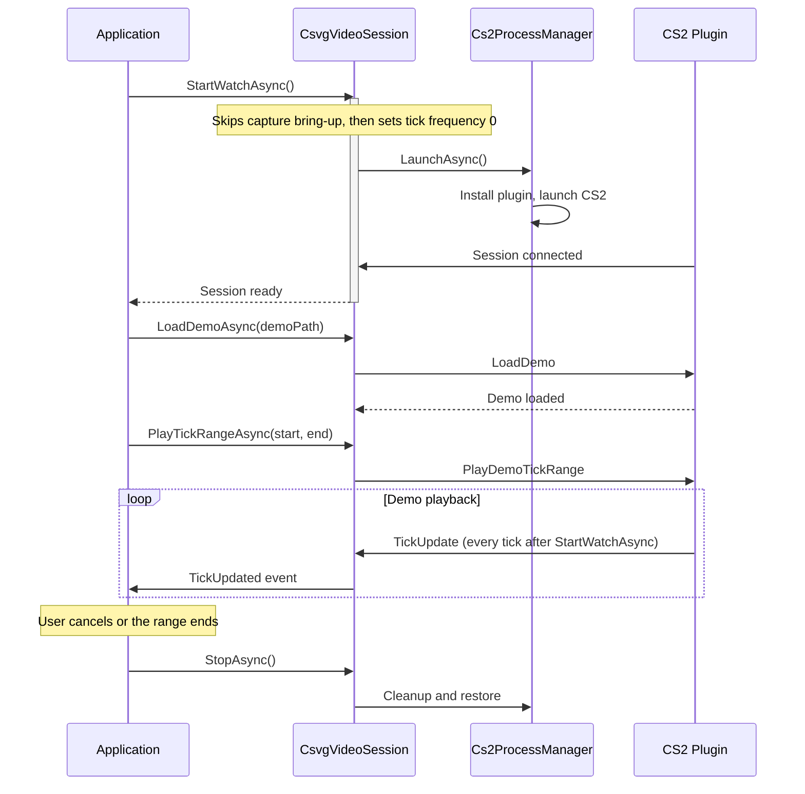
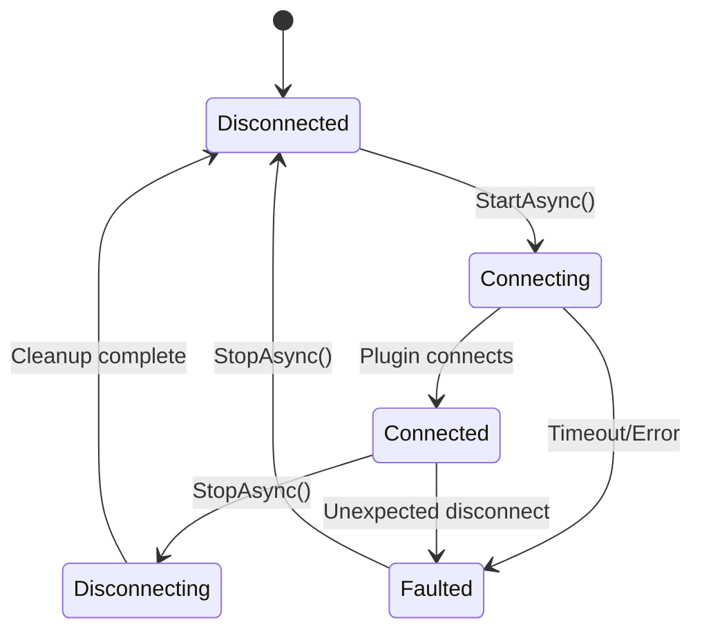
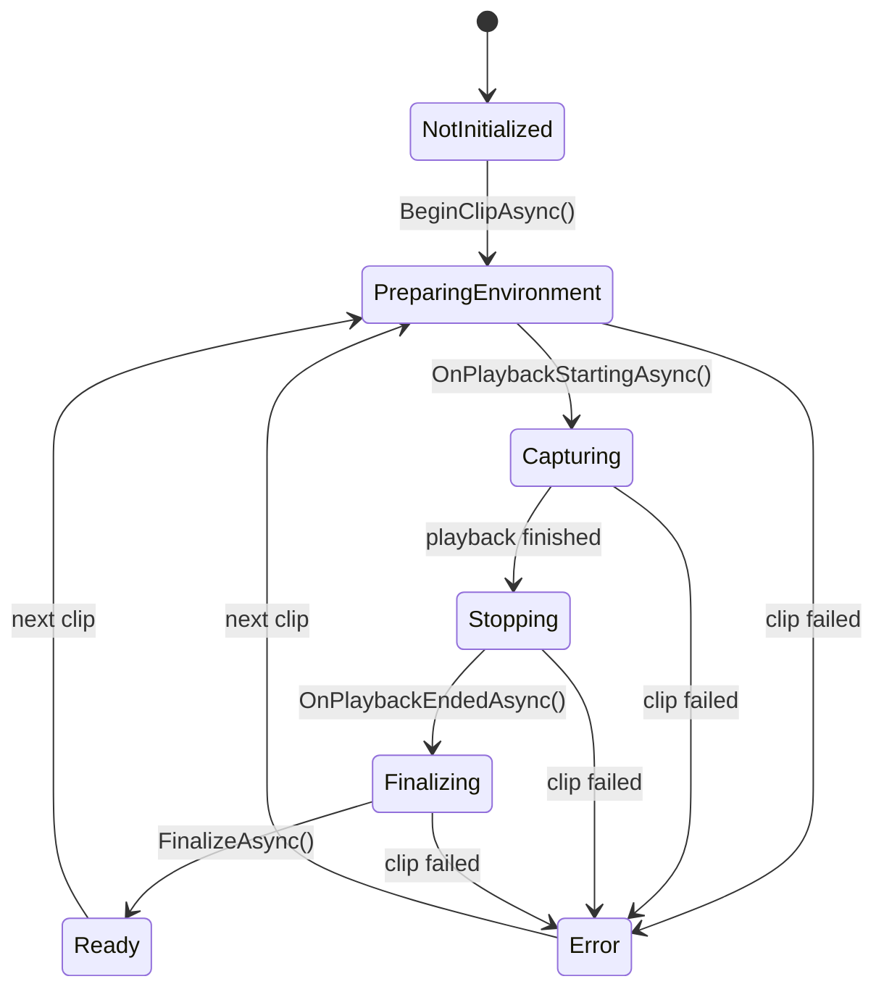

# Cs2VideoGenerator Sequence Diagrams

## Session Lifecycle

Start a session, load a demo, shut down.

> **Note:** Two things the diagram leaves out. Before launching CS2, `StartAsync` self-probes the configured gRPC endpoint and fails fast if `Cs2GameService` is not hosted there. And when the plugin connects it reports its version, HL2SDK commit, and the running CS2 build; CSVG evaluates those with a warn-not-block compatibility check (only known-broken plugin/game pairs fail session start, overridable with `--force`).

Every start creates a fresh `Cs2EngineSession` and a fresh `ICaptureSession`. Nothing
latched by one CS2 run — engine truth, plugin capabilities, a torn-down capture backend —
can be observed by the next one.

## Demo Playback with Recording

Capture problems come back as a failed `CaptureResult`, never as an exception. One bad
clip does not take the CS2 session down with it.

## Compilation Capture Flow

One compilation can pull clips from several demo files.

Output files are numbered by each clip's ORIGINAL position in the compilation
(`{BaseFileName}_000`, `_001`, ...), not by the order the clips were recorded in. The
grouping and tick ordering above exist only to avoid demo reloads and backwards seeks.

## gRPC Bidirectional Stream

## Playback-Only Session (No Recording)

`StartWatchAsync` is the playback-only bootstrap for hosts that mirror playback without
recording. `csvg watch` (`WatchTask`) records by default, so it calls `StartAsync` and skips
capture bring-up only with `--no-capture`.

## State Transitions

## Capture States

`ClipCaptureCoordinator` owns this machine and drives it once per clip; `CsvgVideoSession`
re-publishes the transitions as `CaptureStateChanged`.

